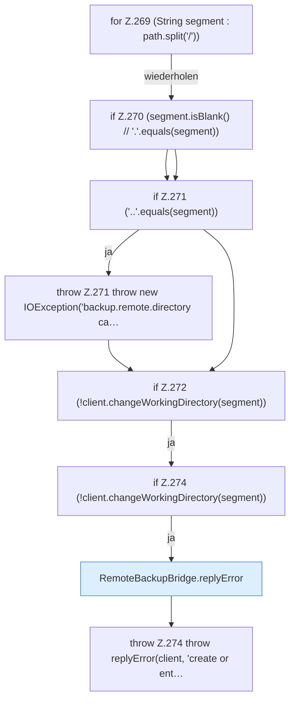

[[00 Start]] › [[Backup]] › [[Backup-Bruecken]] › [[RemoteBackupBridge]] › [[RemoteBackupBridge.Teil2]] › [[RemoteBackupBridge.enterBaseDirectory]] › [[RemoteBackupBridge.enterBaseDirectory.Z269]]

# RemoteBackupBridge.enterBaseDirectory.Z269

- Fortsetzung von `RemoteBackupBridge.enterBaseDirectory`, Quellreihenfolge.
