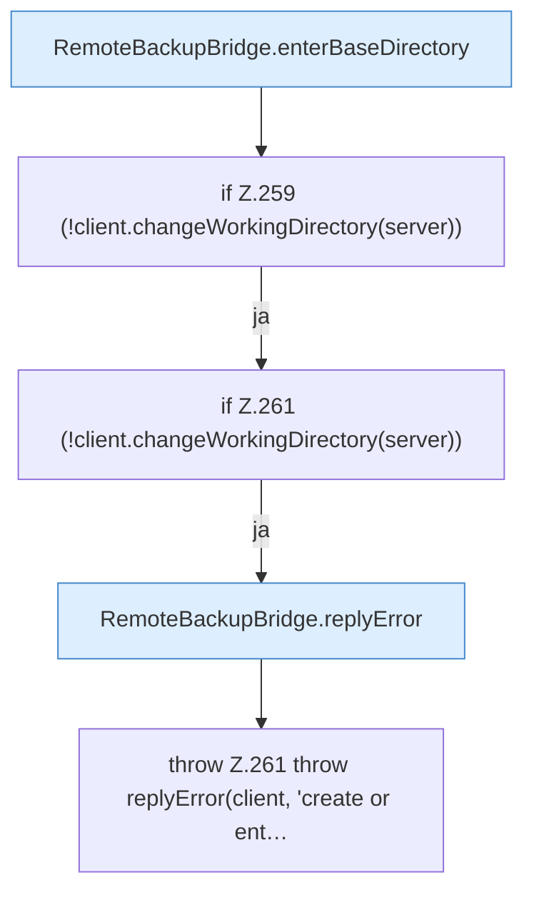

[[00 Start]] › [[Backup]] › [[Backup-Bruecken]] › [[RemoteBackupBridge]] › [[RemoteBackupBridge.Teil2]] › [[RemoteBackupBridge.enterDirectory]]

# RemoteBackupBridge.enterDirectory

`RemoteBackupBridge.enterDirectory(FTPClient client, String directory, String server)` [src/main/java/de/aichele/childlauncher/RemoteBackupBridge.java:257–263](https://github.com/Sciddie/minecraft-serverhoster-plugin/blob/95b02b953b0b4c23673e900e021a7c3c844aa37d/src/main/java/de/aichele/childlauncher/RemoteBackupBridge.java#L257-L263)



```knoten
RemoteBackupBridge.enterBaseDirectory
  Wechselt hinein `enterBaseDirectory`. Ruft `hasControlCharacter`, `replyError`.
if Z.259 (!client.changeWorkingDirectory(server))
  Zeile 259: prüft `(!client.changeWorkingDirectory(server))`.
if Z.261 (!client.changeWorkingDirectory(server))
  Zeile 261: prüft `(!client.changeWorkingDirectory(server))`.
RemoteBackupBridge.replyError
  Antwortet `replyError`.
throw Z.261 throw replyError(client, 'create or ent…
  Zeile 261: Abbruch `throw replyError(client, 'create or ent…`.
```

- `enterDirectory` in `src/main/java/de/aichele/childlauncher/RemoteBackupBridge.java`
