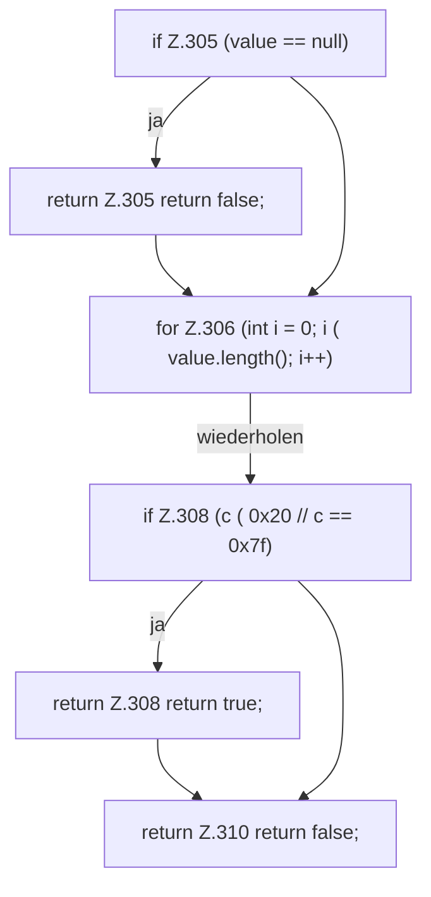

[[00 Start]] › [[Backup]] › [[Backup-Bruecken]] › [[RemoteBackupBridge]] › [[RemoteBackupBridge.Teil3]] › [[RemoteBackupBridge.hasControlCharacter]]

# RemoteBackupBridge.hasControlCharacter

`RemoteBackupBridge.hasControlCharacter(String value)` [src/main/java/de/aichele/childlauncher/RemoteBackupBridge.java:304–311](https://github.com/Sciddie/minecraft-serverhoster-plugin/blob/95b02b953b0b4c23673e900e021a7c3c844aa37d/src/main/java/de/aichele/childlauncher/RemoteBackupBridge.java#L304-L311)



```knoten
if Z.305 (value == null)
  Zeile 305: prüft `(value == null)`.
return Z.305 return false;
  Zeile 305: Rückgabe `return false;`.
for Z.306 (int i = 0; i ( value.length(); i++)
  Zeile 306: Schleife `(int i = 0; i ( value.length(); i++)`.
if Z.308 (c ( 0x20 // c == 0x7f)
  Zeile 308: prüft `(c ( 0x20 // c == 0x7f)`.
return Z.308 return true;
  Zeile 308: Rückgabe `return true;`.
return Z.310 return false;
  Zeile 310: Rückgabe `return false;`.
```

> [!knoten]- Was die Blöcke tun
> - **if Z.305 (value == null)**: Zeile 305: prüft `(value == null)`.
> - **return Z.305 return false;**: Zeile 305: Rückgabe `return false;`.
> - **for Z.306 (int i = 0; i ( value.length(); i++)**: Zeile 306: Schleife `(int i = 0; i ( value.length(); i++)`.
> - **if Z.308 (c ( 0x20 // c == 0x7f)**: Zeile 308: prüft `(c ( 0x20 // c == 0x7f)`.
> - **return Z.308 return true;**: Zeile 308: Rückgabe `return true;`.
> - **return Z.310 return false;**: Zeile 310: Rückgabe `return false;`.

- Die Sicherung über das Netz prüft hier einen Schritt. Eine Ebene tiefer steht er genauer.
- `hasControlCharacter` in `src/main/java/de/aichele/childlauncher/RemoteBackupBridge.java`
