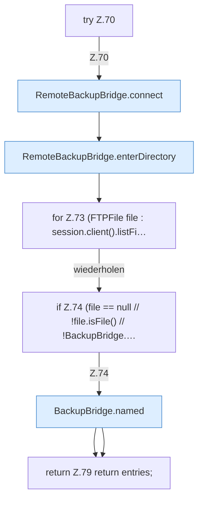

[[00 Start]] › [[Backup]] › [[Backup-Bruecken]] › [[RemoteBackupBridge]] › [[RemoteBackupBridge.Teil1]] › [[RemoteBackupBridge.list]] › [[RemoteBackupBridge.list.Z70]]

# RemoteBackupBridge.list.Z70



```knoten
try Z.70
  Zeile 70: Versuch. Der Fehlerpfad geht in catch.
RemoteBackupBridge.connect
  Verbindet `connect`. Ruft `validateCredentials`, `openFtps`, `openFtp`.
RemoteBackupBridge.enterDirectory
  Wechselt hinein `enterDirectory`. Ruft `enterBaseDirectory`, `replyError`.
for Z.73 (FTPFile file : session.client().listFi…
  Zeile 73: Schleife `(FTPFile file : session.client().listFi…`.
if Z.74 (file == null // !file.isFile() // !BackupBridge.…
  Zeile 74: prüft `(file == null // !file.isFile() // !BackupBridge.…`.
BackupBridge.named
  `named` in `BackupBridge.java`.
return Z.79 return entries;
  Zeile 79: Rückgabe `return entries;`.
```

- Fortsetzung von `RemoteBackupBridge.list`, Quellreihenfolge.
