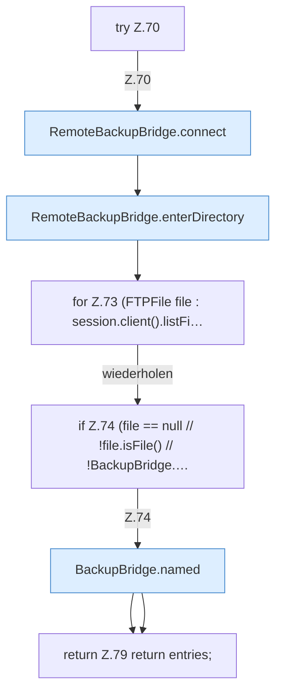

[[00 Start]] › [[Backup]] › [[Backup-Bruecken]] › [[RemoteBackupBridge]] › [[RemoteBackupBridge.Teil1]] › [[RemoteBackupBridge.list]] › [[RemoteBackupBridge.list.Z70]]

# RemoteBackupBridge.list.Z70

- Fortsetzung von `RemoteBackupBridge.list`, Quellreihenfolge.
