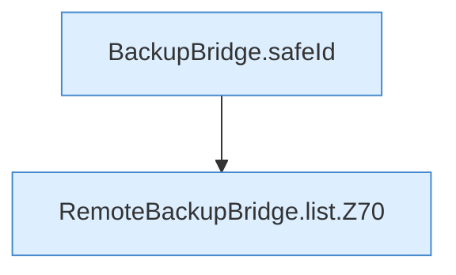

[[00 Start]] › [[Backup]] › [[Backup-Bruecken]] › [[RemoteBackupBridge]] › [[RemoteBackupBridge.Teil1]] › [[RemoteBackupBridge.list]]

# RemoteBackupBridge.list

`RemoteBackupBridge.list(Settings settings, String username, String password, String serverId)` [src/main/java/de/aichele/childlauncher/RemoteBackupBridge.java:67–81](https://github.com/Sciddie/minecraft-serverhoster-plugin/blob/95b02b953b0b4c23673e900e021a7c3c844aa37d/src/main/java/de/aichele/childlauncher/RemoteBackupBridge.java#L67-L81)



```knoten
BackupBridge.safeId
  Die Sicherung auf diesem Rechner kümmert sich um die Kennung. Prüft die Pfadgrenze `safeId`.
RemoteBackupBridge.list.Z70
  Der Ablauf geht in [[Glossar#Zeile|Zeile]] 70 weiter. Eine Ebene tiefer steht er genauer. Fortsetzung des Ablaufs ab Zeile 70.
```

> [!knoten]- Was die Blöcke tun
> - **BackupBridge.safeId**: Die Sicherung auf diesem Rechner kümmert sich um die Kennung. Prüft die Pfadgrenze `safeId`.
> - **RemoteBackupBridge.list.Z70**: Der Ablauf geht in [[Glossar#Zeile|Zeile]] 70 weiter. Eine Ebene tiefer steht er genauer. Fortsetzung des Ablaufs ab Zeile 70.

- Die Sicherung über das Netz zeigt das.
- `list` in `src/main/java/de/aichele/childlauncher/RemoteBackupBridge.java`
