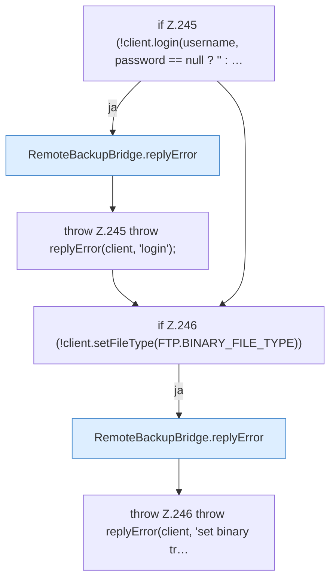

[[00 Start]] › [[Backup]] › [[Backup-Bruecken]] › [[RemoteBackupBridge]] › [[RemoteBackupBridge.Teil2]] › [[RemoteBackupBridge.login]]

# RemoteBackupBridge.login

`RemoteBackupBridge.login(FTPClient client, String username, String password)` [src/main/java/de/aichele/childlauncher/RemoteBackupBridge.java:244–248](https://github.com/Sciddie/minecraft-serverhoster-plugin/blob/95b02b953b0b4c23673e900e021a7c3c844aa37d/src/main/java/de/aichele/childlauncher/RemoteBackupBridge.java#L244-L248)



```knoten
if Z.245 (!client.login(username, password == null ? '' : …
  Zeile 245: prüft `(!client.login(username, password == null ? '' : …`.
RemoteBackupBridge.replyError
  Antwortet `replyError`.
throw Z.245 throw replyError(client, 'login');
  Zeile 245: Abbruch `throw replyError(client, 'login');`.
if Z.246 (!client.setFileType(FTP.BINARY_FILE_TYPE))
  Zeile 246: prüft `(!client.setFileType(FTP.BINARY_FILE_TYPE))`.
throw Z.246 throw replyError(client, 'set binary tr…
  Zeile 246: Abbruch `throw replyError(client, 'set binary tr…`.
```

- `login` in `src/main/java/de/aichele/childlauncher/RemoteBackupBridge.java`
