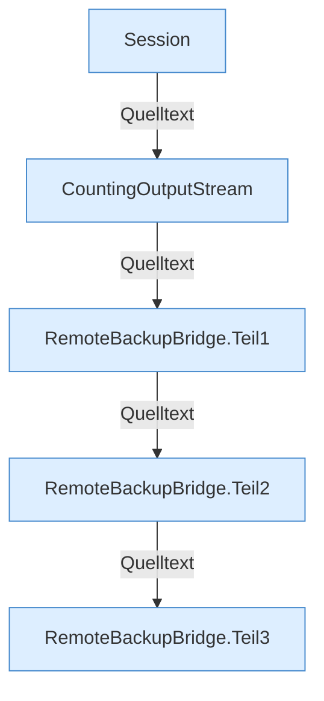

[[00 Start]] › [[Backup]] › [[Backup-Bruecken]] › [[RemoteBackupBridge]]

# RemoteBackupBridge



```knoten
Session
  FTP-Sitzung der Fern-Brücke. close schließt den Client.
CountingOutputStream
  Zählt die Bytes, die ins Backup geschrieben werden.
RemoteBackupBridge.Teil1
  Abschnitt 1 dieses Ablaufs, in Quellreihenfolge.
RemoteBackupBridge.Teil2
  Abschnitt 2 dieses Ablaufs, in Quellreihenfolge.
RemoteBackupBridge.Teil3
  Abschnitt 3 dieses Ablaufs, in Quellreihenfolge.
```


