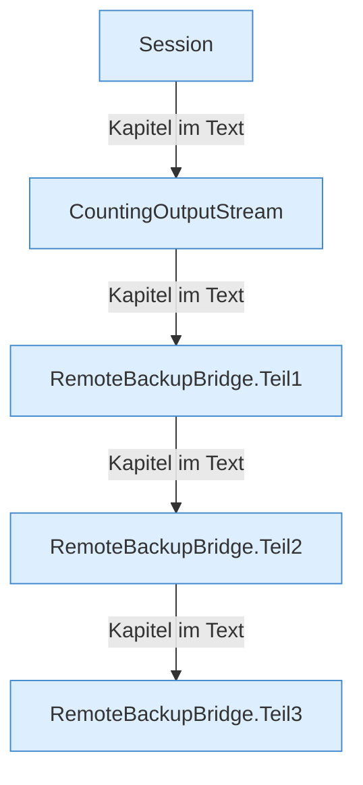

[[00 Start]] › [[Backup]] › [[Backup-Bruecken]] › [[RemoteBackupBridge]]

# RemoteBackupBridge



```knoten
Session
  Die Verbindung zu dem anderen Rechner, solange eine [[Glossar#Sicherungskopie|Sicherungskopie]] übertragen wird. Am Ende wird sie geschlossen.
CountingOutputStream
  Zählt mit, wie viel gerade in die [[Glossar#Sicherungskopie|Sicherungskopie]] geschrieben wurde.
RemoteBackupBridge.Teil1
  Ein weiterer Abschnitt derselben Übersicht. Im [[Glossar#Quelltext|Quelltext]] heißt das `Teil1`.
RemoteBackupBridge.Teil2
  Ein weiterer Abschnitt derselben Übersicht. Im [[Glossar#Quelltext|Quelltext]] heißt das `Teil2`.
RemoteBackupBridge.Teil3
  Ein weiterer Abschnitt derselben Übersicht. Im [[Glossar#Quelltext|Quelltext]] heißt das `Teil3`.
```

> [!knoten]- Was die Blöcke tun
> - **Session**: Die Verbindung zu dem anderen Rechner, solange eine [[Glossar#Sicherungskopie|Sicherungskopie]] übertragen wird. Am Ende wird sie geschlossen.
> - **CountingOutputStream**: Zählt mit, wie viel gerade in die [[Glossar#Sicherungskopie|Sicherungskopie]] geschrieben wurde.
> - **RemoteBackupBridge.Teil1**: Ein weiterer Abschnitt derselben Übersicht. Im [[Glossar#Quelltext|Quelltext]] heißt das `Teil1`.
> - **RemoteBackupBridge.Teil2**: Ein weiterer Abschnitt derselben Übersicht. Im [[Glossar#Quelltext|Quelltext]] heißt das `Teil2`.
> - **RemoteBackupBridge.Teil3**: Ein weiterer Abschnitt derselben Übersicht. Im [[Glossar#Quelltext|Quelltext]] heißt das `Teil3`.

- Schickt die [[Glossar#Sicherungskopie|Sicherungskopie]] über das Netz auf einen anderen Rechner und holt sie von dort zurück.
