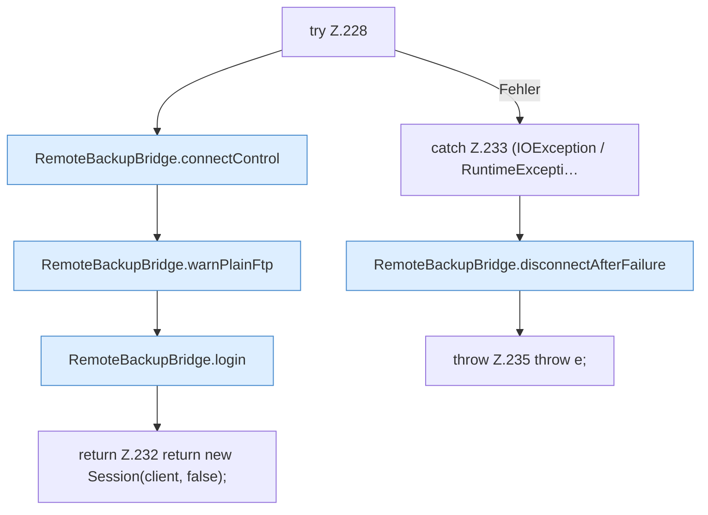

[[00 Start]] › [[Backup]] › [[Backup-Bruecken]] › [[RemoteBackupBridge]] › [[RemoteBackupBridge.Teil2]] › [[RemoteBackupBridge.openFtp]] › [[RemoteBackupBridge.openFtp.Z228]]

# RemoteBackupBridge.openFtp.Z228

- Fortsetzung von `RemoteBackupBridge.openFtp`, Quellreihenfolge.
