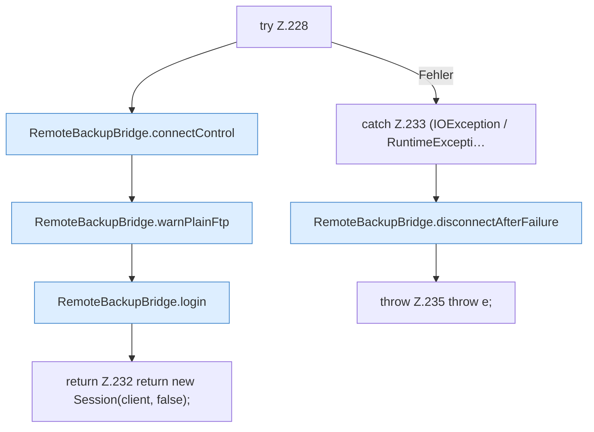

[[00 Start]] › [[Backup]] › [[Backup-Bruecken]] › [[RemoteBackupBridge]] › [[RemoteBackupBridge.Teil2]] › [[RemoteBackupBridge.openFtp]] › [[RemoteBackupBridge.openFtp.Z228]]

# RemoteBackupBridge.openFtp.Z228



```knoten
try Z.228
  Zeile 228: Versuch. Der Fehlerpfad geht in catch.
RemoteBackupBridge.connectControl
  Die Sicherung über das Netz macht hier einen einzelnen Schritt. Eine Ebene tiefer steht er genauer. Verbindet `connectControl`. Ruft `replyError`.
RemoteBackupBridge.warnPlainFtp
  Die Sicherung über das Netz warnt vor die Übertragung. Warnt `warnPlainFtp`.
RemoteBackupBridge.login
  Die Sicherung über das Netz meldet an bei das. Meldet an `login`. Ruft `replyError`.
return Z.232 return new Session(client, false);
  Zeile 232: Rückgabe `return new Session(client, false);`.
catch Z.233 (IOException / RuntimeExcepti…
  Zeile 233: fängt (IOException / RuntimeExcepti….
RemoteBackupBridge.disconnectAfterFailure
  Die Sicherung über das Netz macht hier einen einzelnen Schritt. Eine Ebene tiefer steht er genauer. Trennt `disconnectAfterFailure`. Ruft `disconnect`.
throw Z.235 throw e;
  Zeile 235: Abbruch `throw e;`.
```

> [!knoten]- Was die Blöcke tun
> - **try Z.228**: Zeile 228: Versuch. Der Fehlerpfad geht in catch.
> - **RemoteBackupBridge.connectControl**: Die Sicherung über das Netz macht hier einen einzelnen Schritt. Eine Ebene tiefer steht er genauer. Verbindet `connectControl`. Ruft `replyError`.
> - **RemoteBackupBridge.warnPlainFtp**: Die Sicherung über das Netz warnt vor die Übertragung. Warnt `warnPlainFtp`.
> - **RemoteBackupBridge.login**: Die Sicherung über das Netz meldet an bei das. Meldet an `login`. Ruft `replyError`.
> - **return Z.232 return new Session(client, false);**: Zeile 232: Rückgabe `return new Session(client, false);`.
> - **catch Z.233 (IOException / RuntimeExcepti…**: Zeile 233: fängt (IOException / RuntimeExcepti….
> - **RemoteBackupBridge.disconnectAfterFailure**: Die Sicherung über das Netz macht hier einen einzelnen Schritt. Eine Ebene tiefer steht er genauer. Trennt `disconnectAfterFailure`. Ruft `disconnect`.
> - **throw Z.235 throw e;**: Zeile 235: Abbruch `throw e;`.

- Der Ablauf geht in [[Glossar#Zeile|Zeile]] 228 weiter. Eine Ebene tiefer steht er genauer.
- Fortsetzung von `RemoteBackupBridge.openFtp`.
