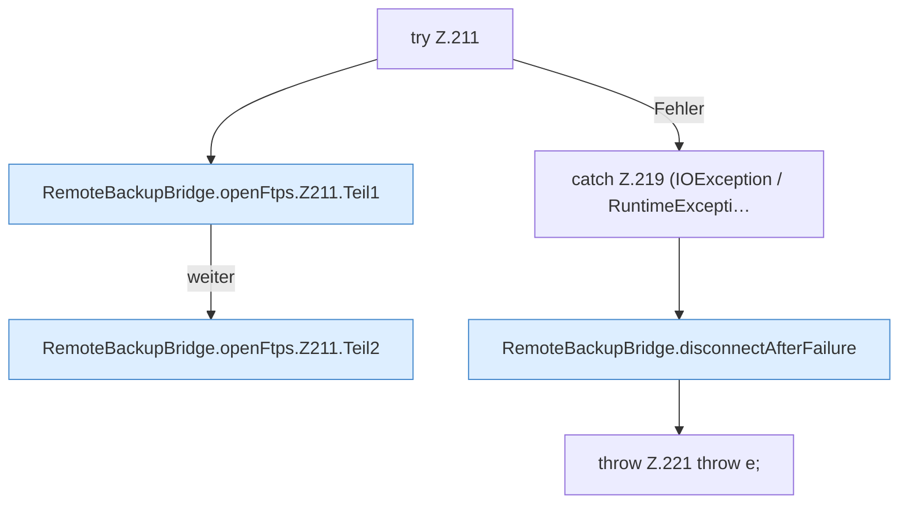

[[00 Start]] › [[Backup]] › [[Backup-Bruecken]] › [[RemoteBackupBridge]] › [[RemoteBackupBridge.Teil2]] › [[RemoteBackupBridge.openFtps]] › [[RemoteBackupBridge.openFtps.Z211]]

# RemoteBackupBridge.openFtps.Z211

- Fortsetzung von `RemoteBackupBridge.openFtps`, Quellreihenfolge.
