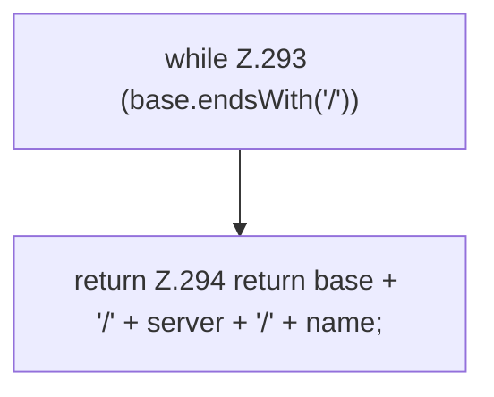

[[00 Start]] › [[Backup]] › [[Backup-Bruecken]] › [[RemoteBackupBridge]] › [[RemoteBackupBridge.Teil3]] › [[RemoteBackupBridge.remotePath]]

# RemoteBackupBridge.remotePath

`RemoteBackupBridge.remotePath(String directory, String server, String name)` [src/main/java/de/aichele/childlauncher/RemoteBackupBridge.java:291–295](https://github.com/Sciddie/minecraft-serverhoster-plugin/blob/95b02b953b0b4c23673e900e021a7c3c844aa37d/src/main/java/de/aichele/childlauncher/RemoteBackupBridge.java#L291-L295)



```knoten
while Z.293 (base.endsWith('/'))
  Zeile 293: Schleife `(base.endsWith('/'))`.
return Z.294 return base + '/' + server + '/' + name;
  Zeile 294: Rückgabe `return base + '/' + server + '/' + name;`.
```

> [!knoten]- Was die Blöcke tun
> - **while Z.293 (base.endsWith('/'))**: Zeile 293: Schleife `(base.endsWith('/'))`.
> - **return Z.294 return base + '/' + server + '/' + name;**: Zeile 294: Rückgabe `return base + '/' + server + '/' + name;`.

- Die Sicherung über das Netz kümmert sich um den Pfad.
- `remotePath` in `src/main/java/de/aichele/childlauncher/RemoteBackupBridge.java`
