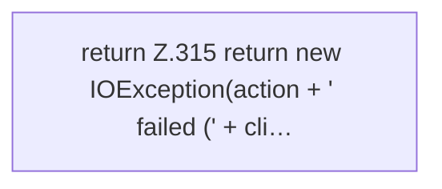

[[00 Start]] › [[Backup]] › [[Backup-Bruecken]] › [[RemoteBackupBridge]] › [[RemoteBackupBridge.Teil3]] › [[RemoteBackupBridge.replyError]]

# RemoteBackupBridge.replyError

`RemoteBackupBridge.replyError(FTPClient client, String action)` [src/main/java/de/aichele/childlauncher/RemoteBackupBridge.java:313–317](https://github.com/Sciddie/minecraft-serverhoster-plugin/blob/95b02b953b0b4c23673e900e021a7c3c844aa37d/src/main/java/de/aichele/childlauncher/RemoteBackupBridge.java#L313-L317)

- `replyError` in `src/main/java/de/aichele/childlauncher/RemoteBackupBridge.java`
