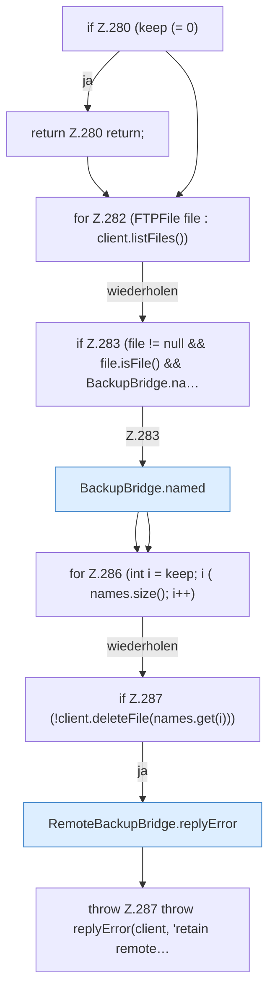

[[00 Start]] › [[Backup]] › [[Backup-Bruecken]] › [[RemoteBackupBridge]] › [[RemoteBackupBridge.Teil3]] › [[RemoteBackupBridge.retain]]

# RemoteBackupBridge.retain

`RemoteBackupBridge.retain(FTPClient client, String server, int keep)` [src/main/java/de/aichele/childlauncher/RemoteBackupBridge.java:279–289](https://github.com/Sciddie/minecraft-serverhoster-plugin/blob/95b02b953b0b4c23673e900e021a7c3c844aa37d/src/main/java/de/aichele/childlauncher/RemoteBackupBridge.java#L279-L289)



```knoten
if Z.280 (keep (= 0)
  Zeile 280: prüft `(keep (= 0)`.
return Z.280 return;
  Zeile 280: Rückgabe `return;`.
for Z.282 (FTPFile file : client.listFiles())
  Zeile 282: Schleife `(FTPFile file : client.listFiles())`.
if Z.283 (file != null && file.isFile() && BackupBridge.na…
  Zeile 283: prüft `(file != null && file.isFile() && BackupBridge.na…`.
BackupBridge.named
  Die Sicherung auf diesem Rechner macht hier einen einzelnen Schritt. Eine Ebene tiefer steht er genauer. `named` in `BackupBridge.java`.
for Z.286 (int i = keep; i ( names.size(); i++)
  Zeile 286: Schleife `(int i = keep; i ( names.size(); i++)`.
if Z.287 (!client.deleteFile(names.get(i)))
  Zeile 287: prüft `(!client.deleteFile(names.get(i)))`.
RemoteBackupBridge.replyError
  Die Sicherung über das Netz macht hier einen einzelnen Schritt. Eine Ebene tiefer steht er genauer. Antwortet `replyError`.
throw Z.287 throw replyError(client, 'retain remote…
  Zeile 287: Abbruch `throw replyError(client, 'retain remote…`.
```

> [!knoten]- Was die Blöcke tun
> - **if Z.280 (keep (= 0)**: Zeile 280: prüft `(keep (= 0)`.
> - **return Z.280 return;**: Zeile 280: Rückgabe `return;`.
> - **for Z.282 (FTPFile file : client.listFiles())**: Zeile 282: Schleife `(FTPFile file : client.listFiles())`.
> - **if Z.283 (file != null && file.isFile() && BackupBridge.na…**: Zeile 283: prüft `(file != null && file.isFile() && BackupBridge.na…`.
> - **BackupBridge.named**: Die Sicherung auf diesem Rechner macht hier einen einzelnen Schritt. Eine Ebene tiefer steht er genauer. `named` in `BackupBridge.java`.
> - **for Z.286 (int i = keep; i ( names.size(); i++)**: Zeile 286: Schleife `(int i = keep; i ( names.size(); i++)`.
> - **if Z.287 (!client.deleteFile(names.get(i)))**: Zeile 287: prüft `(!client.deleteFile(names.get(i)))`.
> - **RemoteBackupBridge.replyError**: Die Sicherung über das Netz macht hier einen einzelnen Schritt. Eine Ebene tiefer steht er genauer. Antwortet `replyError`.
> - **throw Z.287 throw replyError(client, 'retain remote…**: Zeile 287: Abbruch `throw replyError(client, 'retain remote…`.

- Die Sicherung über das Netz macht hier einen einzelnen Schritt. Eine Ebene tiefer steht er genauer.
- `retain` in `src/main/java/de/aichele/childlauncher/RemoteBackupBridge.java`
