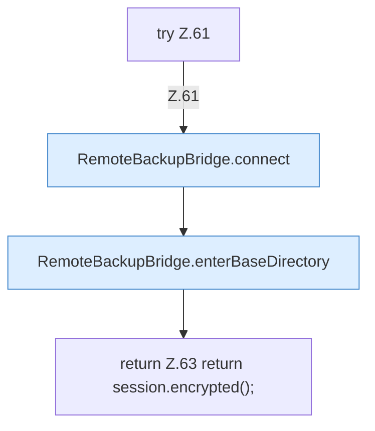

[[00 Start]] › [[Backup]] › [[Backup-Bruecken]] › [[RemoteBackupBridge]] › [[RemoteBackupBridge.Teil1]] › [[RemoteBackupBridge.test]]

# RemoteBackupBridge.test

`RemoteBackupBridge.test(Settings settings, String username, String password)` [src/main/java/de/aichele/childlauncher/RemoteBackupBridge.java:60–65](https://github.com/Sciddie/minecraft-serverhoster-plugin/blob/95b02b953b0b4c23673e900e021a7c3c844aa37d/src/main/java/de/aichele/childlauncher/RemoteBackupBridge.java#L60-L65)



```knoten
try Z.61
  Zeile 61: Versuch. Der Fehlerpfad geht in catch.
RemoteBackupBridge.connect
  Verbindet `connect`. Ruft `validateCredentials`, `openFtps`, `openFtp`.
RemoteBackupBridge.enterBaseDirectory
  Wechselt hinein `enterBaseDirectory`. Ruft `hasControlCharacter`, `replyError`.
return Z.63 return session.encrypted();
  Zeile 63: Rückgabe `return session.encrypted();`.
```

- `test` in `src/main/java/de/aichele/childlauncher/RemoteBackupBridge.java`
