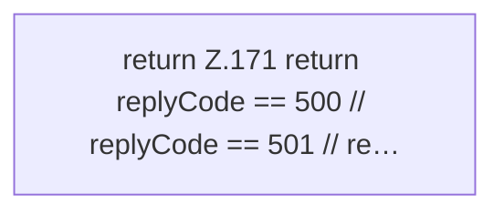

[[00 Start]] › [[Backup]] › [[Backup-Bruecken]] › [[RemoteBackupBridge]] › [[RemoteBackupBridge.Teil1]] › [[RemoteBackupBridge.unsupportedAuthTls]]

# RemoteBackupBridge.unsupportedAuthTls

`RemoteBackupBridge.unsupportedAuthTls(int replyCode)` [src/main/java/de/aichele/childlauncher/RemoteBackupBridge.java:170–172](https://github.com/Sciddie/minecraft-serverhoster-plugin/blob/95b02b953b0b4c23673e900e021a7c3c844aa37d/src/main/java/de/aichele/childlauncher/RemoteBackupBridge.java#L170-L172)



```knoten
return Z.171 return replyCode == 500 // replyCode == 501 // re…
  Zeile 171: Rückgabe `return replyCode == 500 // replyCode == 501 // re…`.
```

> [!knoten]- Was die Blöcke tun
> - **return Z.171 return replyCode == 500 // replyCode == 501 // re…**: Zeile 171: Rückgabe `return replyCode == 500 // replyCode == 501 // re…`.

- Die Sicherung über das Netz macht hier einen einzelnen Schritt. Eine Ebene tiefer steht er genauer.
- `unsupportedAuthTls` in `src/main/java/de/aichele/childlauncher/RemoteBackupBridge.java`
