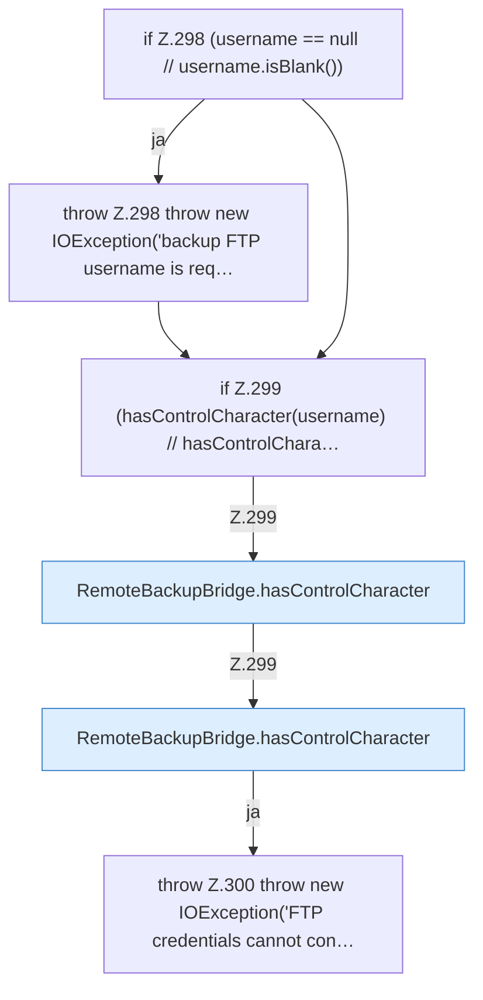

[[00 Start]] › [[Backup]] › [[Backup-Bruecken]] › [[RemoteBackupBridge]] › [[RemoteBackupBridge.Teil3]] › [[RemoteBackupBridge.validateCredentials]]

# RemoteBackupBridge.validateCredentials

`RemoteBackupBridge.validateCredentials(String username, String password)` [src/main/java/de/aichele/childlauncher/RemoteBackupBridge.java:297–302](https://github.com/Sciddie/minecraft-serverhoster-plugin/blob/95b02b953b0b4c23673e900e021a7c3c844aa37d/src/main/java/de/aichele/childlauncher/RemoteBackupBridge.java#L297-L302)



```knoten
if Z.298 (username == null // username.isBlank())
  Zeile 298: prüft `(username == null // username.isBlank())`.
throw Z.298 throw new IOException('backup FTP username is req…
  Zeile 298: Abbruch `throw new IOException('backup FTP username is req…`.
if Z.299 (hasControlCharacter(username) // hasControlChara…
  Zeile 299: prüft `(hasControlCharacter(username) // hasControlChara…`.
RemoteBackupBridge.hasControlCharacter
  Die Sicherung über das Netz prüft hier einen Schritt. Eine Ebene tiefer steht er genauer. Prüft `hasControlCharacter`.
throw Z.300 throw new IOException('FTP credentials cannot con…
  Zeile 300: Abbruch `throw new IOException('FTP credentials cannot con…`.
```

> [!knoten]- Was die Blöcke tun
> - **if Z.298 (username == null // username.isBlank())**: Zeile 298: prüft `(username == null // username.isBlank())`.
> - **throw Z.298 throw new IOException('backup FTP username is req…**: Zeile 298: Abbruch `throw new IOException('backup FTP username is req…`.
> - **if Z.299 (hasControlCharacter(username) // hasControlChara…**: Zeile 299: prüft `(hasControlCharacter(username) // hasControlChara…`.
> - **RemoteBackupBridge.hasControlCharacter**: Die Sicherung über das Netz prüft hier einen Schritt. Eine Ebene tiefer steht er genauer. Prüft `hasControlCharacter`.
> - **throw Z.300 throw new IOException('FTP credentials cannot con…**: Zeile 300: Abbruch `throw new IOException('FTP credentials cannot con…`.

- Die Sicherung über das Netz prüft die Zugangsdaten.
- `validateCredentials` in `src/main/java/de/aichele/childlauncher/RemoteBackupBridge.java`
