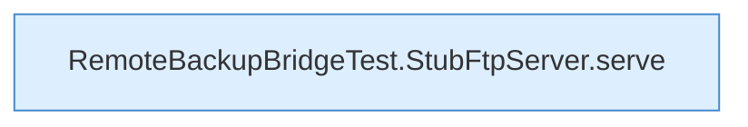

[[00 Start]] › [[Tests]] › [[RemoteBackupBridgeTest]] › [[RemoteBackupBridgeTest.StubFtpServer.StubFtpServer]]

# RemoteBackupBridgeTest.StubFtpServer.StubFtpServer

`RemoteBackupBridgeTest.StubFtpServer.StubFtpServer()` [src/test/java/de/aichele/childlauncher/RemoteBackupBridgeTest.java:79–85](https://github.com/Sciddie/minecraft-serverhoster-plugin/blob/95b02b953b0b4c23673e900e021a7c3c844aa37d/src/test/java/de/aichele/childlauncher/RemoteBackupBridgeTest.java#L79-L85)



```knoten
RemoteBackupBridgeTest.StubFtpServer.serve
  Ein Schritt in einem [[Glossar#Probelauf|Probelauf]]. Er gehört nicht zum laufenden Server. Im [[Glossar#Quelltext|Quelltext]] heißt das `serve`.
```

> [!knoten]- Was die Blöcke tun
> - **RemoteBackupBridgeTest.StubFtpServer.serve**: Ein Schritt in einem [[Glossar#Probelauf|Probelauf]]. Er gehört nicht zum laufenden Server. Im [[Glossar#Quelltext|Quelltext]] heißt das `serve`.

- Ein Schritt in einem [[Glossar#Probelauf|Probelauf]]. Er gehört nicht zum laufenden Server.
- Das ist ein Probelauf, kein Teil des laufenden Servers.
