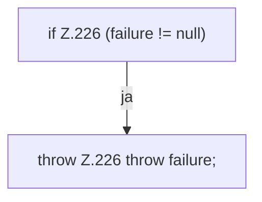

[[00 Start]] › [[Tests]] › [[RemoteBackupBridgeTest]] › [[RemoteBackupBridgeTest.StubFtpServer.close]]

# RemoteBackupBridgeTest.StubFtpServer.close

`RemoteBackupBridgeTest.StubFtpServer.close()` [src/test/java/de/aichele/childlauncher/RemoteBackupBridgeTest.java:222–227](https://github.com/Sciddie/minecraft-serverhoster-plugin/blob/95b02b953b0b4c23673e900e021a7c3c844aa37d/src/test/java/de/aichele/childlauncher/RemoteBackupBridgeTest.java#L222-L227)



```knoten
if Z.226 (failure != null)
  Zeile 226: prüft `(failure != null)`.
throw Z.226 throw failure;
  Zeile 226: Abbruch `throw failure;`.
```

- `close` in `src/test/java/de/aichele/childlauncher/RemoteBackupBridgeTest.java`
- Auslöser: Test
