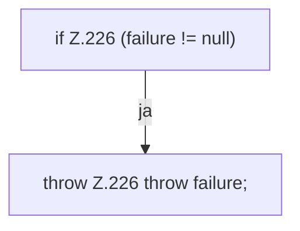

[[00 Start]] › [[Tests]] › [[RemoteBackupBridgeTest]] › [[RemoteBackupBridgeTest.StubFtpServer.close]]

# RemoteBackupBridgeTest.StubFtpServer.close

`RemoteBackupBridgeTest.StubFtpServer.close()` [src/test/java/de/aichele/childlauncher/RemoteBackupBridgeTest.java:222–227](https://github.com/Sciddie/minecraft-serverhoster-plugin/blob/95b02b953b0b4c23673e900e021a7c3c844aa37d/src/test/java/de/aichele/childlauncher/RemoteBackupBridgeTest.java#L222-L227)



```knoten
if Z.226 (failure != null)
  Hier fällt eine Entscheidung. Nur wenn sie zutrifft, geht es den Ja-Weg weiter. Das steht in [[Glossar#Zeile|Zeile]] 226.
throw Z.226 throw failure;
  Hier bricht die [[Glossar#Funktion|Funktion]] ab, weil etwas nicht geklappt hat. Das steht in [[Glossar#Zeile|Zeile]] 226.
```

> [!knoten]- Was die Blöcke tun
> - **if Z.226 (failure != null)**: Hier fällt eine Entscheidung. Nur wenn sie zutrifft, geht es den Ja-Weg weiter. Das steht in [[Glossar#Zeile|Zeile]] 226.
> - **throw Z.226 throw failure;**: Hier bricht die [[Glossar#Funktion|Funktion]] ab, weil etwas nicht geklappt hat. Das steht in [[Glossar#Zeile|Zeile]] 226.

- Ein Schritt in einem [[Glossar#Probelauf|Probelauf]]. Er gehört nicht zum laufenden Server.
- Das ist ein Probelauf, kein Teil des laufenden Servers.
