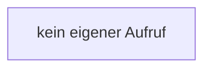

[[00 Start]] › [[Tests]] › [[RemoteBackupBridgeTest]] › [[RemoteBackupBridgeTest.StubFtpServer.ftpWriter]] › [[RemoteBackupBridgeTest.StubFtpServer.ftpWriter.println]]

# RemoteBackupBridgeTest.StubFtpServer.ftpWriter.println

`RemoteBackupBridgeTest.StubFtpServer.println(String line)` [src/test/java/de/aichele/childlauncher/RemoteBackupBridgeTest.java:214–218](https://github.com/Sciddie/minecraft-serverhoster-plugin/blob/95b02b953b0b4c23673e900e021a7c3c844aa37d/src/test/java/de/aichele/childlauncher/RemoteBackupBridgeTest.java#L214-L218)

- `println` in `src/test/java/de/aichele/childlauncher/RemoteBackupBridgeTest.java`
- Auslöser: Test
