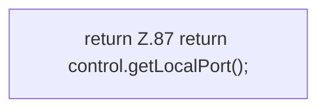

[[00 Start]] › [[Tests]] › [[RemoteBackupBridgeTest]] › [[RemoteBackupBridgeTest.StubFtpServer.port]]

# RemoteBackupBridgeTest.StubFtpServer.port

`RemoteBackupBridgeTest.StubFtpServer.port()` [src/test/java/de/aichele/childlauncher/RemoteBackupBridgeTest.java:87–87](https://github.com/Sciddie/minecraft-serverhoster-plugin/blob/95b02b953b0b4c23673e900e021a7c3c844aa37d/src/test/java/de/aichele/childlauncher/RemoteBackupBridgeTest.java#L87-L87)

- `port` in `src/test/java/de/aichele/childlauncher/RemoteBackupBridgeTest.java`
- Auslöser: Test
