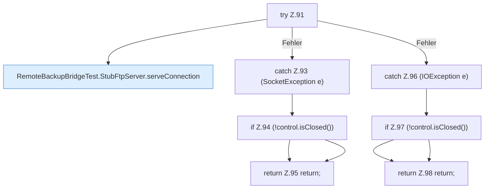

[[00 Start]] › [[Tests]] › [[RemoteBackupBridgeTest]] › [[RemoteBackupBridgeTest.StubFtpServer.serve]] › [[RemoteBackupBridgeTest.StubFtpServer.serve.Z90.Z91]]

# RemoteBackupBridgeTest.StubFtpServer.serve.Z90.Z91



```knoten
try Z.91
  Zeile 91: Versuch. Der Fehlerpfad geht in catch.
RemoteBackupBridgeTest.StubFtpServer.serveConnection
  Liefert `serveConnection`. Ruft `ftpWriter`. Nur Test.
catch Z.93 (SocketException e)
  Zeile 93: fängt (SocketException e).
if Z.94 (!control.isClosed())
  Zeile 94: prüft `(!control.isClosed())`.
return Z.95 return;
  Zeile 95: Rückgabe `return;`.
catch Z.96 (IOException e)
  Zeile 96: fängt (IOException e).
if Z.97 (!control.isClosed())
  Zeile 97: prüft `(!control.isClosed())`.
return Z.98 return;
  Zeile 98: Rückgabe `return;`.
```

- Fortsetzung von `RemoteBackupBridgeTest.StubFtpServer.serve.Z90`, Quellreihenfolge.
