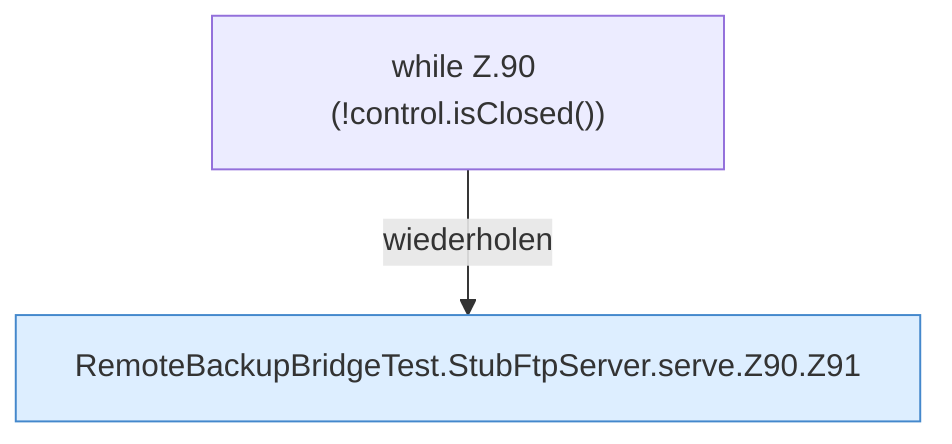

[[00 Start]] › [[Tests]] › [[RemoteBackupBridgeTest]] › [[RemoteBackupBridgeTest.StubFtpServer.serve]] › [[RemoteBackupBridgeTest.StubFtpServer.serve.Z90]]

# RemoteBackupBridgeTest.StubFtpServer.serve.Z90

- Fortsetzung von `RemoteBackupBridgeTest.StubFtpServer.serve`, Quellreihenfolge.
