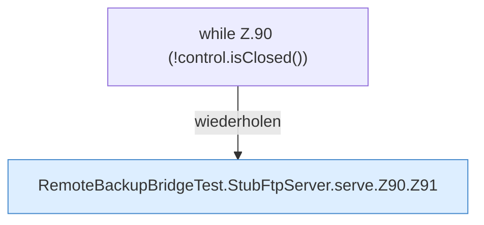

[[00 Start]] › [[Tests]] › [[RemoteBackupBridgeTest]] › [[RemoteBackupBridgeTest.StubFtpServer.serve]] › [[RemoteBackupBridgeTest.StubFtpServer.serve.Z90]]

# RemoteBackupBridgeTest.StubFtpServer.serve.Z90



```knoten
while Z.90 (!control.isClosed())
  Zeile 90: Schleife `(!control.isClosed())`.
RemoteBackupBridgeTest.StubFtpServer.serve.Z90.Z91
  Der Ablauf geht in [[Glossar#Zeile|Zeile]] 91 weiter. Eine Ebene tiefer steht er genauer. Fortsetzung des Ablaufs ab Zeile 91.
```

> [!knoten]- Was die Blöcke tun
> - **while Z.90 (!control.isClosed())**: Zeile 90: Schleife `(!control.isClosed())`.
> - **RemoteBackupBridgeTest.StubFtpServer.serve.Z90.Z91**: Der Ablauf geht in [[Glossar#Zeile|Zeile]] 91 weiter. Eine Ebene tiefer steht er genauer. Fortsetzung des Ablaufs ab Zeile 91.

- Der Ablauf geht in [[Glossar#Zeile|Zeile]] 90 weiter. Eine Ebene tiefer steht er genauer.
- Fortsetzung von `RemoteBackupBridgeTest.StubFtpServer.serve`.
