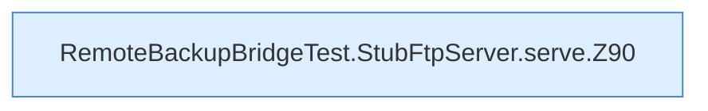

[[00 Start]] › [[Tests]] › [[RemoteBackupBridgeTest]] › [[RemoteBackupBridgeTest.StubFtpServer.serve]]

# RemoteBackupBridgeTest.StubFtpServer.serve

`RemoteBackupBridgeTest.StubFtpServer.serve()` [src/test/java/de/aichele/childlauncher/RemoteBackupBridgeTest.java:89–101](https://github.com/Sciddie/minecraft-serverhoster-plugin/blob/95b02b953b0b4c23673e900e021a7c3c844aa37d/src/test/java/de/aichele/childlauncher/RemoteBackupBridgeTest.java#L89-L101)



```knoten
RemoteBackupBridgeTest.StubFtpServer.serve.Z90
  Fortsetzung des Ablaufs ab Zeile 90.
```

- `serve` in `src/test/java/de/aichele/childlauncher/RemoteBackupBridgeTest.java`
- Auslöser: Test
