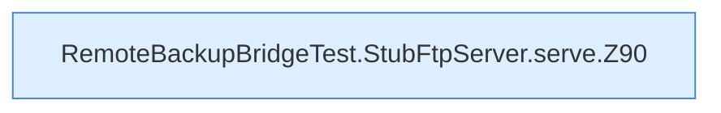

[[00 Start]] › [[Tests]] › [[RemoteBackupBridgeTest]] › [[RemoteBackupBridgeTest.StubFtpServer.serve]]

# RemoteBackupBridgeTest.StubFtpServer.serve

`RemoteBackupBridgeTest.StubFtpServer.serve()` [src/test/java/de/aichele/childlauncher/RemoteBackupBridgeTest.java:89–101](https://github.com/Sciddie/minecraft-serverhoster-plugin/blob/95b02b953b0b4c23673e900e021a7c3c844aa37d/src/test/java/de/aichele/childlauncher/RemoteBackupBridgeTest.java#L89-L101)



```knoten
RemoteBackupBridgeTest.StubFtpServer.serve.Z90
  Der Ablauf geht in [[Glossar#Zeile|Zeile]] 90 weiter. Eine Ebene tiefer steht er genauer. Im [[Glossar#Quelltext|Quelltext]] heißt das `Z90`.
```

> [!knoten]- Was die Blöcke tun
> - **RemoteBackupBridgeTest.StubFtpServer.serve.Z90**: Der Ablauf geht in [[Glossar#Zeile|Zeile]] 90 weiter. Eine Ebene tiefer steht er genauer. Im [[Glossar#Quelltext|Quelltext]] heißt das `Z90`.

- Ein Schritt in einem [[Glossar#Probelauf|Probelauf]]. Er gehört nicht zum laufenden Server.
- Das ist ein Probelauf, kein Teil des laufenden Servers.
