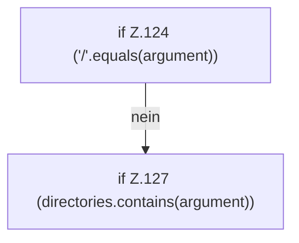

[[00 Start]] › [[Tests]] › [[RemoteBackupBridgeTest]] › [[RemoteBackupBridgeTest.StubFtpServer.serveConnection]] › [[RemoteBackupBridgeTest.StubFtpServer.serveConnection.Z104.Z113.Z117.Case123.Z124]]

# RemoteBackupBridgeTest.StubFtpServer.serveConnection.Z104.Z113.Z117.Case123.Z124



```knoten
if Z.124 ('/'.equals(argument))
  Zeile 124: prüft `('/'.equals(argument))`.
if Z.127 (directories.contains(argument))
  Zeile 127: prüft `(directories.contains(argument))`.
```

- Fortsetzung von `RemoteBackupBridgeTest.StubFtpServer.serveConnection.Z104.Z113.Z117.Case123`, Quellreihenfolge.
