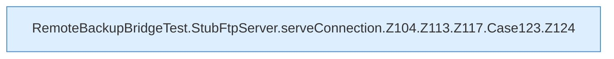

[[00 Start]] › [[Tests]] › [[RemoteBackupBridgeTest]] › [[RemoteBackupBridgeTest.StubFtpServer.serveConnection]] › [[RemoteBackupBridgeTest.StubFtpServer.serveConnection.Z104.Z113.Z117.Case123]]

# RemoteBackupBridgeTest.StubFtpServer.serveConnection.Z104.Z113.Z117.Case123



```knoten
RemoteBackupBridgeTest.StubFtpServer.serveConnection.Z104.Z113.Z117.Case123.Z124
  Der Ablauf geht in [[Glossar#Zeile|Zeile]] 124 weiter. Eine Ebene tiefer steht er genauer. Fortsetzung des Ablaufs ab Zeile 124.
```

> [!knoten]- Was die Blöcke tun
> - **RemoteBackupBridgeTest.StubFtpServer.serveConnection.Z104.Z113.Z117.Case123.Z124**: Der Ablauf geht in [[Glossar#Zeile|Zeile]] 124 weiter. Eine Ebene tiefer steht er genauer. Fortsetzung des Ablaufs ab Zeile 124.

- Das Innere eines Wegs, ab [[Glossar#Zeile|Zeile]] 123.
- Fortsetzung von `RemoteBackupBridgeTest.StubFtpServer.serveConnection.Z104.Z113.Z117`.
