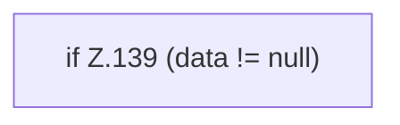

[[00 Start]] › [[Tests]] › [[RemoteBackupBridgeTest]] › [[RemoteBackupBridgeTest.StubFtpServer.serveConnection]] › [[RemoteBackupBridgeTest.StubFtpServer.serveConnection.Z104.Z113.Z117.Case138]]

# RemoteBackupBridgeTest.StubFtpServer.serveConnection.Z104.Z113.Z117.Case138



```knoten
if Z.139 (data != null)
  Zeile 139: prüft `(data != null)`.
```

- Fortsetzung von `RemoteBackupBridgeTest.StubFtpServer.serveConnection.Z104.Z113.Z117`, Quellreihenfolge.
