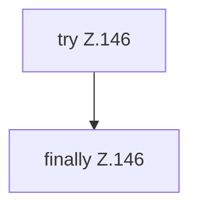

[[00 Start]] › [[Tests]] › [[RemoteBackupBridgeTest]] › [[RemoteBackupBridgeTest.StubFtpServer.serveConnection]] › [[RemoteBackupBridgeTest.StubFtpServer.serveConnection.Z104.Z113.Z117.Case144]]

# RemoteBackupBridgeTest.StubFtpServer.serveConnection.Z104.Z113.Z117.Case144



```knoten
try Z.146
  Zeile 146: Versuch. Der Fehlerpfad geht in catch.
finally Z.146
  Läuft danach immer, auch nach einem Fehler.
```

> [!knoten]- Was die Blöcke tun
> - **try Z.146**: Zeile 146: Versuch. Der Fehlerpfad geht in catch.
> - **finally Z.146**: Läuft danach immer, auch nach einem Fehler.

- Das Innere eines Wegs, ab [[Glossar#Zeile|Zeile]] 144.
- Fortsetzung von `RemoteBackupBridgeTest.StubFtpServer.serveConnection.Z104.Z113.Z117`.
