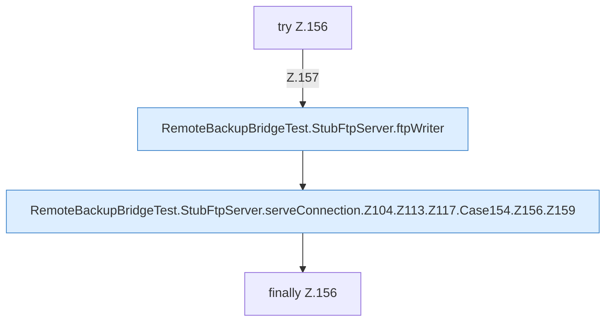

[[00 Start]] › [[Tests]] › [[RemoteBackupBridgeTest]] › [[RemoteBackupBridgeTest.StubFtpServer.serveConnection]] › [[RemoteBackupBridgeTest.StubFtpServer.serveConnection.Z104.Z113.Z117.Case154.Z156]]

# RemoteBackupBridgeTest.StubFtpServer.serveConnection.Z104.Z113.Z117.Case154.Z156



```knoten
try Z.156
  Zeile 156: Versuch. Der Fehlerpfad geht in catch.
RemoteBackupBridgeTest.StubFtpServer.ftpWriter
  `ftpWriter` in `RemoteBackupBridgeTest.java`. Ruft `println`. Nur Test.
RemoteBackupBridgeTest.StubFtpServer.serveConnection.Z104.Z113.Z117.Case154.Z156.Z159
  Fortsetzung des Ablaufs ab Zeile 159.
finally Z.156
  Läuft danach immer, auch nach einem Fehler.
```

- Fortsetzung von `RemoteBackupBridgeTest.StubFtpServer.serveConnection.Z104.Z113.Z117.Case154`, Quellreihenfolge.
