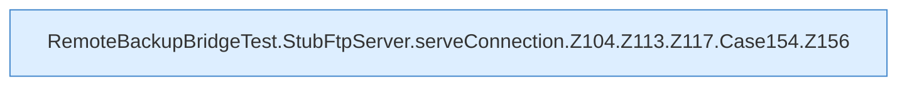

[[00 Start]] › [[Tests]] › [[RemoteBackupBridgeTest]] › [[RemoteBackupBridgeTest.StubFtpServer.serveConnection]] › [[RemoteBackupBridgeTest.StubFtpServer.serveConnection.Z104.Z113.Z117.Case154]]

# RemoteBackupBridgeTest.StubFtpServer.serveConnection.Z104.Z113.Z117.Case154



```knoten
RemoteBackupBridgeTest.StubFtpServer.serveConnection.Z104.Z113.Z117.Case154.Z156
  Fortsetzung des Ablaufs ab Zeile 156.
```

- Fortsetzung von `RemoteBackupBridgeTest.StubFtpServer.serveConnection.Z104.Z113.Z117`, Quellreihenfolge.
