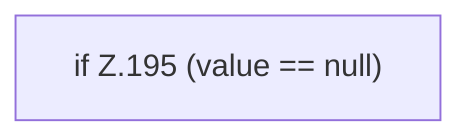

[[00 Start]] › [[Tests]] › [[RemoteBackupBridgeTest]] › [[RemoteBackupBridgeTest.StubFtpServer.serveConnection]] › [[RemoteBackupBridgeTest.StubFtpServer.serveConnection.Z104.Z113.Z117.Case193]]

# RemoteBackupBridgeTest.StubFtpServer.serveConnection.Z104.Z113.Z117.Case193



```knoten
if Z.195 (value == null)
  Zeile 195: prüft `(value == null)`.
```

> [!knoten]- Was die Blöcke tun
> - **if Z.195 (value == null)**: Zeile 195: prüft `(value == null)`.

- Das Innere eines Wegs, ab [[Glossar#Zeile|Zeile]] 193.
- Fortsetzung von `RemoteBackupBridgeTest.StubFtpServer.serveConnection.Z104.Z113.Z117`.
