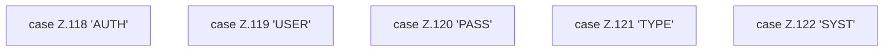

[[00 Start]] › [[Tests]] › [[RemoteBackupBridgeTest]] › [[RemoteBackupBridgeTest.StubFtpServer.serveConnection]] › [[RemoteBackupBridgeTest.StubFtpServer.serveConnection.Z104.Z113.Z117.Cases118]]

# RemoteBackupBridgeTest.StubFtpServer.serveConnection.Z104.Z113.Z117.Cases118



```knoten
case Z.118 'AUTH'
  Zeile 118: Zweig `'AUTH'`.
case Z.119 'USER'
  Zeile 119: Zweig `'USER'`.
case Z.120 'PASS'
  Zeile 120: Zweig `'PASS'`.
case Z.121 'TYPE'
  Zeile 121: Zweig `'TYPE'`.
case Z.122 'SYST'
  Zeile 122: Zweig `'SYST'`.
```

- Fortsetzung von `RemoteBackupBridgeTest.StubFtpServer.serveConnection.Z104.Z113.Z117`, Quellreihenfolge.
