[[00 Start]] › [[Tests]] › [[RemoteBackupBridgeTest]] › [[RemoteBackupBridgeTest.StubFtpServer.serveConnection]] › [[RemoteBackupBridgeTest.StubFtpServer.serveConnection.Z104.Z113.Z117.Cases123]]

# RemoteBackupBridgeTest.StubFtpServer.serveConnection.Z104.Z113.Z117.Cases123

```mermaid
flowchart TD
  n1["case Z.123 'CWD'"]
  n2["RemoteBackupBridgeTest.StubFtpServer.serveConnection.Z104.Z113.Z117.Case123"]:::internal-link
  n3["case Z.134 'MKD'"]
  n4["case Z.138 'PASV'"]
  n5["RemoteBackupBridgeTest.StubFtpServer.serveConnection.Z104.Z113.Z117.Case138"]:::internal-link
  n6["case Z.144 'STOR'"]
  n7["RemoteBackupBridgeTest.StubFtpServer.serveConnection.Z104.Z113.Z117.Case144"]:::internal-link
  n8["case Z.154 'LIST'"]
  n9["RemoteBackupBridgeTest.StubFtpServer.serveConnection.Z104.Z113.Z117.Case154"]:::internal-link
  n1 --> n2
  n4 --> n5
  n6 --> n7
  n8 --> n9
  classDef internal-link fill:#ddeeff,stroke:#4488cc
  classDef befund fill:#f88
```

- Fortsetzung von `RemoteBackupBridgeTest.StubFtpServer.serveConnection.Z104.Z113.Z117`, Quellreihenfolge.
