[[00 Start]] › [[Tests]] › [[RemoteBackupBridgeTest]] › [[RemoteBackupBridgeTest.StubFtpServer.serveConnection]] › [[RemoteBackupBridgeTest.StubFtpServer.serveConnection.Z104.Z113.Z117.Cases123]]

# RemoteBackupBridgeTest.StubFtpServer.serveConnection.Z104.Z113.Z117.Cases123

```mermaid
flowchart TD
  n1["case Z.123 'CWD'"]
  n2["RemoteBackupBridgeTest.StubFtpServer.serveConnection.Z104.Z113.Z117.Case123"]:::internal-link
  n3["case Z.134 'MKD'"]
  n4["case Z.138 'PASV'"]
  n5["RemoteBackupBridgeTest.StubFtpServer.serveConnection.Z104.Z113.Z117.Case138"]:::internal-link
  n6["case Z.144 'STOR'"]
  n7["RemoteBackupBridgeTest.StubFtpServer.serveConnection.Z104.Z113.Z117.Case144"]:::internal-link
  n8["case Z.154 'LIST'"]
  n9["RemoteBackupBridgeTest.StubFtpServer.serveConnection.Z104.Z113.Z117.Case154"]:::internal-link
  n1 --> n2
  n4 --> n5
  n6 --> n7
  n8 --> n9
  classDef internal-link fill:#ddeeff,stroke:#4488cc
  classDef befund fill:#f88
```



```knoten
case Z.123 'CWD'
  Zeile 123: Zweig `'CWD'`.
RemoteBackupBridgeTest.StubFtpServer.serveConnection.Z104.Z113.Z117.Case123
  Rumpf dieses switch-Zweigs ab Zeile 123.
case Z.134 'MKD'
  Zeile 134: Zweig `'MKD'`.
case Z.138 'PASV'
  Zeile 138: Zweig `'PASV'`.
RemoteBackupBridgeTest.StubFtpServer.serveConnection.Z104.Z113.Z117.Case138
  Rumpf dieses switch-Zweigs ab Zeile 138.
case Z.144 'STOR'
  Zeile 144: Zweig `'STOR'`.
RemoteBackupBridgeTest.StubFtpServer.serveConnection.Z104.Z113.Z117.Case144
  Rumpf dieses switch-Zweigs ab Zeile 144.
case Z.154 'LIST'
  Zeile 154: Zweig `'LIST'`.
RemoteBackupBridgeTest.StubFtpServer.serveConnection.Z104.Z113.Z117.Case154
  Rumpf dieses switch-Zweigs ab Zeile 154.
```

- Fortsetzung von `RemoteBackupBridgeTest.StubFtpServer.serveConnection.Z104.Z113.Z117`, Quellreihenfolge.
