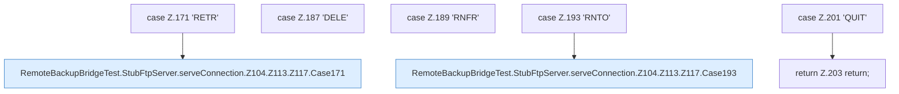

[[00 Start]] › [[Tests]] › [[RemoteBackupBridgeTest]] › [[RemoteBackupBridgeTest.StubFtpServer.serveConnection]] › [[RemoteBackupBridgeTest.StubFtpServer.serveConnection.Z104.Z113.Z117.Cases171]]

# RemoteBackupBridgeTest.StubFtpServer.serveConnection.Z104.Z113.Z117.Cases171



```knoten
case Z.171 'RETR'
  Zeile 171: Zweig `'RETR'`.
RemoteBackupBridgeTest.StubFtpServer.serveConnection.Z104.Z113.Z117.Case171
  Das Innere eines Wegs, ab [[Glossar#Zeile|Zeile]] 171. Rumpf dieses switch-Zweigs ab Zeile 171.
case Z.187 'DELE'
  Zeile 187: Zweig `'DELE'`.
case Z.189 'RNFR'
  Zeile 189: Zweig `'RNFR'`.
case Z.193 'RNTO'
  Zeile 193: Zweig `'RNTO'`.
RemoteBackupBridgeTest.StubFtpServer.serveConnection.Z104.Z113.Z117.Case193
  Das Innere eines Wegs, ab [[Glossar#Zeile|Zeile]] 193. Rumpf dieses switch-Zweigs ab Zeile 193.
case Z.201 'QUIT'
  Zeile 201: Zweig `'QUIT'`.
return Z.203 return;
  Zeile 203: Rückgabe `return;`.
```

> [!knoten]- Was die Blöcke tun
> - **case Z.171 'RETR'**: Zeile 171: Zweig `'RETR'`.
> - **RemoteBackupBridgeTest.StubFtpServer.serveConnection.Z104.Z113.Z117.Case171**: Das Innere eines Wegs, ab [[Glossar#Zeile|Zeile]] 171. Rumpf dieses switch-Zweigs ab Zeile 171.
> - **case Z.187 'DELE'**: Zeile 187: Zweig `'DELE'`.
> - **case Z.189 'RNFR'**: Zeile 189: Zweig `'RNFR'`.
> - **case Z.193 'RNTO'**: Zeile 193: Zweig `'RNTO'`.
> - **RemoteBackupBridgeTest.StubFtpServer.serveConnection.Z104.Z113.Z117.Case193**: Das Innere eines Wegs, ab [[Glossar#Zeile|Zeile]] 193. Rumpf dieses switch-Zweigs ab Zeile 193.
> - **case Z.201 'QUIT'**: Zeile 201: Zweig `'QUIT'`.
> - **return Z.203 return;**: Zeile 203: Rückgabe `return;`.

- Weitere Wege der Entscheidung in [[Glossar#Zeile|Zeile]] 171.
- Fortsetzung von `RemoteBackupBridgeTest.StubFtpServer.serveConnection.Z104.Z113.Z117`.
