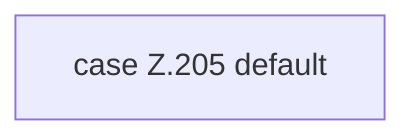

[[00 Start]] › [[Tests]] › [[RemoteBackupBridgeTest]] › [[RemoteBackupBridgeTest.StubFtpServer.serveConnection]] › [[RemoteBackupBridgeTest.StubFtpServer.serveConnection.Z104.Z113.Z117.Cases205]]

# RemoteBackupBridgeTest.StubFtpServer.serveConnection.Z104.Z113.Z117.Cases205



```knoten
case Z.205 default
  Zeile 205: Zweig `default`.
```

> [!knoten]- Was die Blöcke tun
> - **case Z.205 default**: Zeile 205: Zweig `default`.

- Weitere Wege der Entscheidung in [[Glossar#Zeile|Zeile]] 205.
- Fortsetzung von `RemoteBackupBridgeTest.StubFtpServer.serveConnection.Z104.Z113.Z117`.
