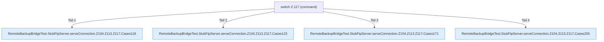

[[00 Start]] › [[Tests]] › [[RemoteBackupBridgeTest]] › [[RemoteBackupBridgeTest.StubFtpServer.serveConnection]] › [[RemoteBackupBridgeTest.StubFtpServer.serveConnection.Z104.Z113.Z117]]

# RemoteBackupBridgeTest.StubFtpServer.serveConnection.Z104.Z113.Z117



```knoten
switch Z.117 (command)
  Zeile 117: Verzweigung nach `(command)`.
RemoteBackupBridgeTest.StubFtpServer.serveConnection.Z104.Z113.Z117.Cases118
  Weitere switch-Zweige ab Zeile 118.
RemoteBackupBridgeTest.StubFtpServer.serveConnection.Z104.Z113.Z117.Cases123
  Weitere switch-Zweige ab Zeile 123.
RemoteBackupBridgeTest.StubFtpServer.serveConnection.Z104.Z113.Z117.Cases171
  Weitere switch-Zweige ab Zeile 171.
RemoteBackupBridgeTest.StubFtpServer.serveConnection.Z104.Z113.Z117.Cases205
  Weitere switch-Zweige ab Zeile 205.
```

- Fortsetzung von `RemoteBackupBridgeTest.StubFtpServer.serveConnection.Z104.Z113`, Quellreihenfolge.
