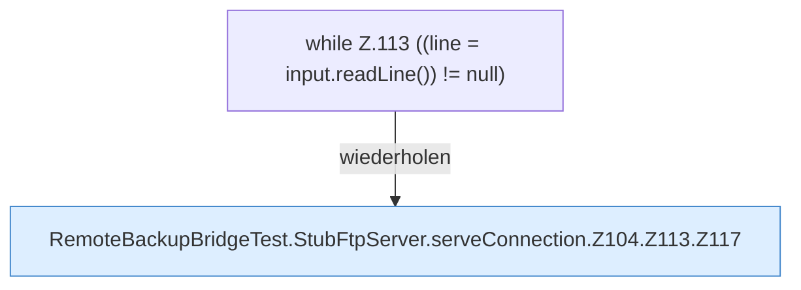

[[00 Start]] › [[Tests]] › [[RemoteBackupBridgeTest]] › [[RemoteBackupBridgeTest.StubFtpServer.serveConnection]] › [[RemoteBackupBridgeTest.StubFtpServer.serveConnection.Z104.Z113]]

# RemoteBackupBridgeTest.StubFtpServer.serveConnection.Z104.Z113

- Fortsetzung von `RemoteBackupBridgeTest.StubFtpServer.serveConnection.Z104`, Quellreihenfolge.
