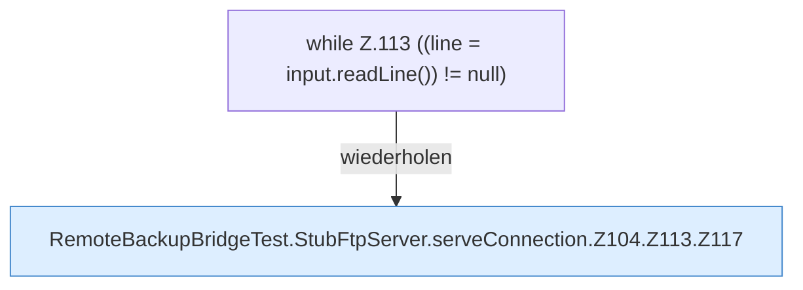

[[00 Start]] › [[Tests]] › [[RemoteBackupBridgeTest]] › [[RemoteBackupBridgeTest.StubFtpServer.serveConnection]] › [[RemoteBackupBridgeTest.StubFtpServer.serveConnection.Z104.Z113]]

# RemoteBackupBridgeTest.StubFtpServer.serveConnection.Z104.Z113



```knoten
while Z.113 ((line = input.readLine()) != null)
  Zeile 113: Schleife `((line = input.readLine()) != null)`.
RemoteBackupBridgeTest.StubFtpServer.serveConnection.Z104.Z113.Z117
  Der Ablauf geht in [[Glossar#Zeile|Zeile]] 117 weiter. Eine Ebene tiefer steht er genauer. Fortsetzung des Ablaufs ab Zeile 117.
```

> [!knoten]- Was die Blöcke tun
> - **while Z.113 ((line = input.readLine()) != null)**: Zeile 113: Schleife `((line = input.readLine()) != null)`.
> - **RemoteBackupBridgeTest.StubFtpServer.serveConnection.Z104.Z113.Z117**: Der Ablauf geht in [[Glossar#Zeile|Zeile]] 117 weiter. Eine Ebene tiefer steht er genauer. Fortsetzung des Ablaufs ab Zeile 117.

- Der Ablauf geht in [[Glossar#Zeile|Zeile]] 113 weiter. Eine Ebene tiefer steht er genauer.
- Fortsetzung von `RemoteBackupBridgeTest.StubFtpServer.serveConnection.Z104`.
