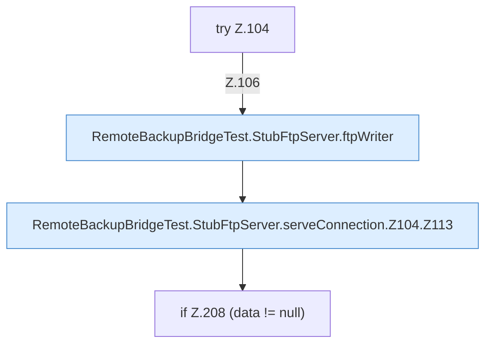

[[00 Start]] › [[Tests]] › [[RemoteBackupBridgeTest]] › [[RemoteBackupBridgeTest.StubFtpServer.serveConnection]] › [[RemoteBackupBridgeTest.StubFtpServer.serveConnection.Z104]]

# RemoteBackupBridgeTest.StubFtpServer.serveConnection.Z104



```knoten
try Z.104
  Zeile 104: Versuch. Der Fehlerpfad geht in catch.
RemoteBackupBridgeTest.StubFtpServer.ftpWriter
  Ein Schritt in einem [[Glossar#Probelauf|Probelauf]]. Er gehört nicht zum laufenden Server. `ftpWriter` in `RemoteBackupBridgeTest.java`. Ruft `println`. Nur Test.
RemoteBackupBridgeTest.StubFtpServer.serveConnection.Z104.Z113
  Der Ablauf geht in [[Glossar#Zeile|Zeile]] 113 weiter. Eine Ebene tiefer steht er genauer. Fortsetzung des Ablaufs ab Zeile 113.
if Z.208 (data != null)
  Zeile 208: prüft `(data != null)`.
```

> [!knoten]- Was die Blöcke tun
> - **try Z.104**: Zeile 104: Versuch. Der Fehlerpfad geht in catch.
> - **RemoteBackupBridgeTest.StubFtpServer.ftpWriter**: Ein Schritt in einem [[Glossar#Probelauf|Probelauf]]. Er gehört nicht zum laufenden Server. `ftpWriter` in `RemoteBackupBridgeTest.java`. Ruft `println`. Nur Test.
> - **RemoteBackupBridgeTest.StubFtpServer.serveConnection.Z104.Z113**: Der Ablauf geht in [[Glossar#Zeile|Zeile]] 113 weiter. Eine Ebene tiefer steht er genauer. Fortsetzung des Ablaufs ab Zeile 113.
> - **if Z.208 (data != null)**: Zeile 208: prüft `(data != null)`.

- Der Ablauf geht in [[Glossar#Zeile|Zeile]] 104 weiter. Eine Ebene tiefer steht er genauer.
- Fortsetzung von `RemoteBackupBridgeTest.StubFtpServer.serveConnection`.
