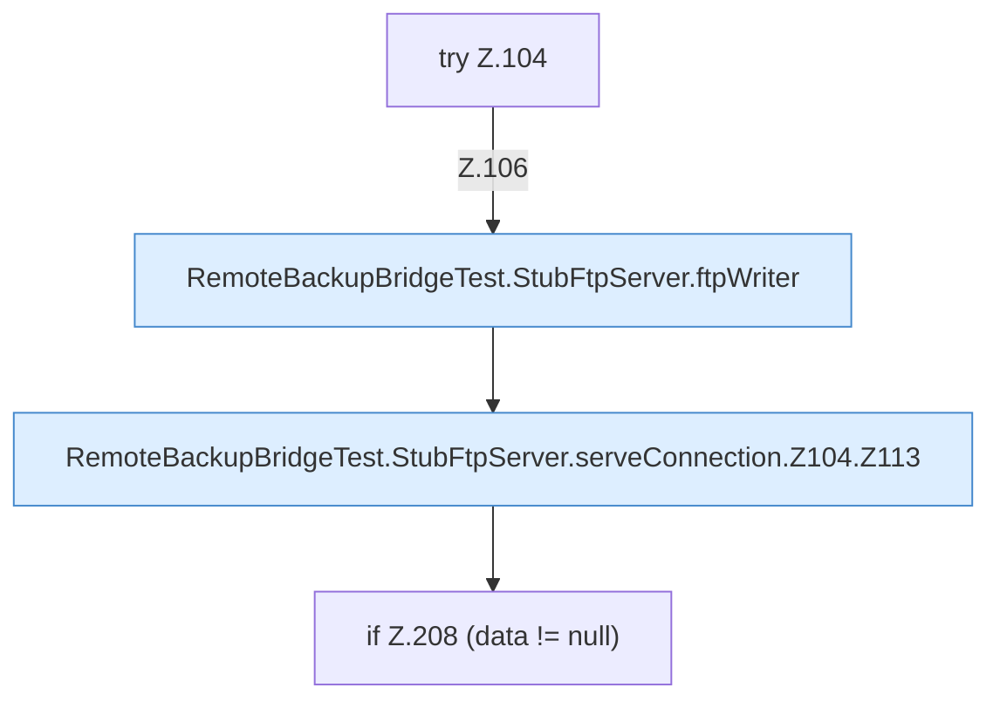

[[00 Start]] › [[Tests]] › [[RemoteBackupBridgeTest]] › [[RemoteBackupBridgeTest.StubFtpServer.serveConnection]] › [[RemoteBackupBridgeTest.StubFtpServer.serveConnection.Z104]]

# RemoteBackupBridgeTest.StubFtpServer.serveConnection.Z104

- Fortsetzung von `RemoteBackupBridgeTest.StubFtpServer.serveConnection`, Quellreihenfolge.
