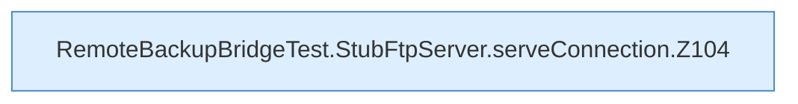

[[00 Start]] › [[Tests]] › [[RemoteBackupBridgeTest]] › [[RemoteBackupBridgeTest.StubFtpServer.serveConnection]]

# RemoteBackupBridgeTest.StubFtpServer.serveConnection

`RemoteBackupBridgeTest.StubFtpServer.serveConnection(Socket socket)` [src/test/java/de/aichele/childlauncher/RemoteBackupBridgeTest.java:103–210](https://github.com/Sciddie/minecraft-serverhoster-plugin/blob/95b02b953b0b4c23673e900e021a7c3c844aa37d/src/test/java/de/aichele/childlauncher/RemoteBackupBridgeTest.java#L103-L210)



```knoten
RemoteBackupBridgeTest.StubFtpServer.serveConnection.Z104
  Fortsetzung des Ablaufs ab Zeile 104.
```

- `serveConnection` in `src/test/java/de/aichele/childlauncher/RemoteBackupBridgeTest.java`
- Auslöser: Test
