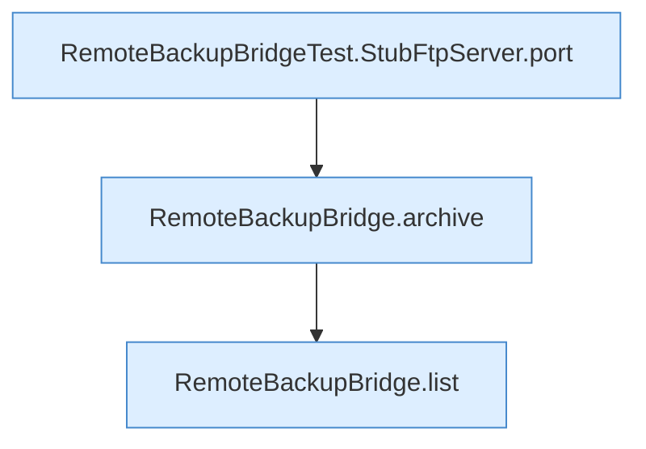

[[00 Start]] › [[Tests]] › [[RemoteBackupBridgeTest]] › [[RemoteBackupBridgeTest.autoModeStreamsFtpBackupAndFinalizesPartialUpload]] › [[RemoteBackupBridgeTest.autoModeStreamsFtpBackupAndFinalizesPartialUpload.Z37.Teil1]]

# RemoteBackupBridgeTest.autoModeStreamsFtpBackupAndFinalizesPartialUpload.Z37.Teil1



```knoten
RemoteBackupBridgeTest.StubFtpServer.port
  Ein Schritt in einem [[Glossar#Probelauf|Probelauf]]. Er gehört nicht zum laufenden Server. Prüft oder liefert den [[Glossar#Port|Port]] `port`. Nur Test.
RemoteBackupBridge.archive
  Die Sicherung über das Netz macht hier einen einzelnen Schritt. Eine Ebene tiefer steht er genauer. Packt `archive`. Ruft `open`, `safeId`, `connect`.
RemoteBackupBridge.list
  Die Sicherung über das Netz zeigt das. Listet `list`. Ruft `safeId`, `connect`, `enterDirectory`.
```

> [!knoten]- Was die Blöcke tun
> - **RemoteBackupBridgeTest.StubFtpServer.port**: Ein Schritt in einem [[Glossar#Probelauf|Probelauf]]. Er gehört nicht zum laufenden Server. Prüft oder liefert den [[Glossar#Port|Port]] `port`. Nur Test.
> - **RemoteBackupBridge.archive**: Die Sicherung über das Netz macht hier einen einzelnen Schritt. Eine Ebene tiefer steht er genauer. Packt `archive`. Ruft `open`, `safeId`, `connect`.
> - **RemoteBackupBridge.list**: Die Sicherung über das Netz zeigt das. Listet `list`. Ruft `safeId`, `connect`, `enterDirectory`.

- Ein weiterer Abschnitt derselben Übersicht.
- Fortsetzung von `RemoteBackupBridgeTest.autoModeStreamsFtpBackupAndFinalizesPartialUpload.Z37`.
