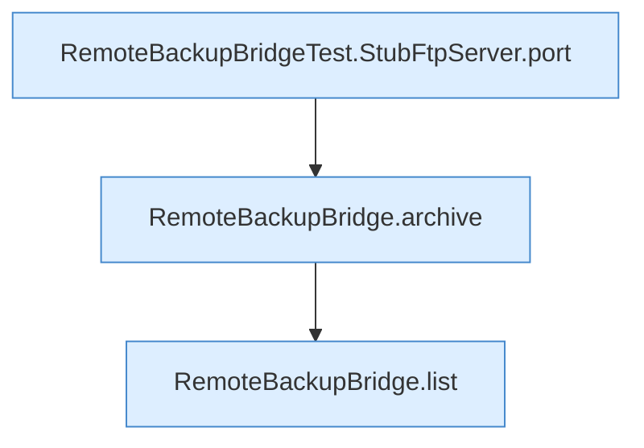

[[00 Start]] › [[Tests]] › [[RemoteBackupBridgeTest]] › [[RemoteBackupBridgeTest.autoModeStreamsFtpBackupAndFinalizesPartialUpload]] › [[RemoteBackupBridgeTest.autoModeStreamsFtpBackupAndFinalizesPartialUpload.Z37.Teil1]]

# RemoteBackupBridgeTest.autoModeStreamsFtpBackupAndFinalizesPartialUpload.Z37.Teil1



```knoten
RemoteBackupBridgeTest.StubFtpServer.port
  Prüft oder liefert den Port `port`. Nur Test.
RemoteBackupBridge.archive
  Packt `archive`. Ruft `open`, `safeId`, `connect`.
RemoteBackupBridge.list
  Listet `list`. Ruft `safeId`, `connect`, `enterDirectory`.
```

- Fortsetzung von `RemoteBackupBridgeTest.autoModeStreamsFtpBackupAndFinalizesPartialUpload.Z37`, Quellreihenfolge.
