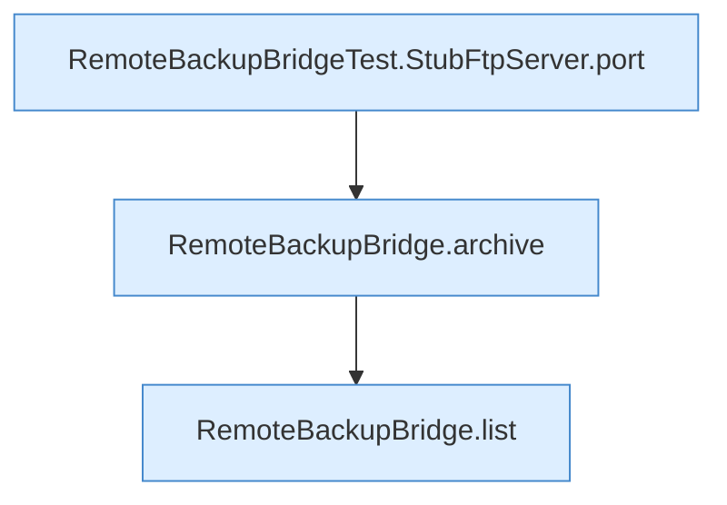

[[00 Start]] › [[Tests]] › [[RemoteBackupBridgeTest]] › [[RemoteBackupBridgeTest.autoModeStreamsFtpBackupAndFinalizesPartialUpload]] › [[RemoteBackupBridgeTest.autoModeStreamsFtpBackupAndFinalizesPartialUpload.Z37.Teil1]]

# RemoteBackupBridgeTest.autoModeStreamsFtpBackupAndFinalizesPartialUpload.Z37.Teil1

- Fortsetzung von `RemoteBackupBridgeTest.autoModeStreamsFtpBackupAndFinalizesPartialUpload.Z37`, Quellreihenfolge.
