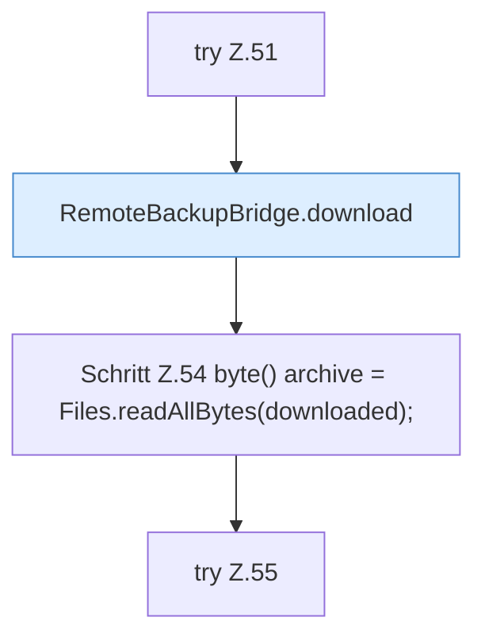

[[00 Start]] › [[Tests]] › [[RemoteBackupBridgeTest]] › [[RemoteBackupBridgeTest.autoModeStreamsFtpBackupAndFinalizesPartialUpload]] › [[RemoteBackupBridgeTest.autoModeStreamsFtpBackupAndFinalizesPartialUpload.Z37.Teil2]]

# RemoteBackupBridgeTest.autoModeStreamsFtpBackupAndFinalizesPartialUpload.Z37.Teil2



```knoten
try Z.51
  Zeile 51: Versuch. Der Fehlerpfad geht in catch.
RemoteBackupBridge.download
  Liefert zum Herunterladen `download`. Ruft `safeId`, `named`, `connect`.
Schritt Z.54 byte() archive = Files.readAllBytes(downloaded);
  Zeile 54: Dateioperation. `byte() archive = Files.readAllBytes(downloaded);`
try Z.55
  Zeile 55: Versuch. Der Fehlerpfad geht in catch.
```

- Fortsetzung von `RemoteBackupBridgeTest.autoModeStreamsFtpBackupAndFinalizesPartialUpload.Z37`, Quellreihenfolge.
